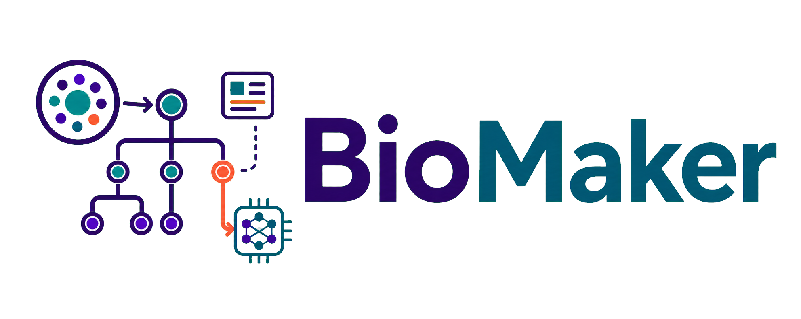

<p align="center">
  
</p>

# Introduction
**BioMaker** is an agentic development system for biomedical image analysis.

BioMaker uses a collaborative multi-agent workflow: an Orchestrator coordinates a Data Analyzer, Researcher, Programmer, and Summarizer through shared Memory. Together, they analyze the data, retrieve implementation knowledge, generate and refine candidate solutions, and package the selected result. The workflow can use a lightweight MONAI knowledge index and web search when extra biomedical implementation context is useful.

# Quick Start

## Setup environment

We recommend using `uv` to manage the environment and dependencies.

1. **Install uv** (if you haven't already):
     ```bash
     pip install uv
     ```
     or using the standalone installer:
     ```bash
     curl -LsSf https://astral.sh/uv/install.sh | sh
     ```

2. **Clone the repository**:
     ```bash
     git clone https://github.com/uni-medical/BioMaker
     cd BioMaker
     ```

3. **Create and sync a Python 3.11 environment**:
     ```bash
     uv sync --python 3.11
     ```

4. **Set up API keys**:
Create `.env` in the repository root. BioMaker, its RAG tools, and the WebUI use this same file regardless of their launch directory. Serper and Jina are optional but recommended for web search: Serper finds relevant pages, and Jina reads those pages into cleaner text.
     ```dotenv
     OPENAI_BASE_URL="<your base url>" # (e.g. https://api.openai.com/v1)
     OPENAI_API_KEY="<your key>"
     BIOMAKER_EMBEDDING_BASE_URL="<your embedding base url>" # optional
     BIOMAKER_EMBEDDING_API_KEY="<your embedding key>"       # optional
     SERPER_API_KEY="<your serper key>"
     JINA_API_KEY="<your jina key>"
     ```
Set `BIOMAKER_ENV_FILE` to an absolute path, or a path relative to the repository root, to use a different file explicitly. Existing shell environment variables still take precedence when running the BioMaker CLI directly.
The repository default is `deepseek-v4-flash` for every model role. The WebUI Settings dialog can store a default model in `.env`; a task-level model override takes precedence. For CLI runs, pass `model_for_all_agents=<model>` explicitly.
The embedding variables are only needed when the embedding endpoint differs from the main OpenAI-compatible endpoint. If `SERPER_API_KEY` is missing, BioMaker warns and disables web search for that run. If `JINA_API_KEY` is missing, BioMaker warns and falls back to Serper snippets only.

5. **Set up the MONAI RAG index**
BioMaker keeps the RAG index local instead of storing generated index files in git. The default `keyword` mode works locally without an embedding API. Build it once before running tasks:
     ```bash
     bash scripts/create_rag_db.sh
     ```

     To use the paper-described embedding retrieval with `text-embedding-3-large`:
     ```bash
     BIOMAKER_RAG_MODE=embedding bash scripts/create_rag_db.sh
     ```
     At run time, select it with `BIOMAKER_RAG_MODE=embedding` (or `agent.knowledge_base.retrieval_mode=embedding`). Both modes share `chunks.jsonl`; embedding mode additionally requires matching vectors and a compatible embedding endpoint.

     Check whether the index is usable:
     ```bash
     uv run python -m biomaker.monai_rag.query_rag_db
     ```
If the index is missing, BioMaker warns and disables MONAI RAG for that run.

## Web interface

Start the local WebUI from the repository root:
```bash
cd apps/webui
uv run python -m webui.server --host 127.0.0.1 --port 7860
```
Open <http://127.0.0.1:7860>, configure the endpoint and API key in Settings, then select a local dataset folder to start an experiment. The experiment list is read directly from `logs/`, grouped by dataset, and uses the existing log directory names.

## Workflow

The default run is intentionally simple:

```text
prepare workspace and data
-> Orchestrator coordinates specialized agents through shared Memory
   -> Data Analyzer profiles the dataset
   -> Researcher retrieves relevant knowledge when needed
   -> Programmer generates and refines executable candidates
-> execute and evaluate candidates in the solution tree
-> Summarizer packages the best-observed solution and optional final report
```

The multi-agent workflow uses a lightweight solution tree search. BioMaker generates candidate solutions, debugs failed nodes, and refines promising ones based on execution results recorded in shared Memory. When the configured budget ends, the Summarizer packages the best-observed solution.

Generated code runs under a strict dependency policy. BioMaker tells the model which installed packages are allowed, blocks package installation, and performs a preflight import check before execution. If code imports an unavailable package such as `cv2` or `albumentations`, the run fails fast with a policy error so the next debug step can replace it with an allowed package.

## Test with Example Dataset
You can download the example dataset from [Huggingface](https://huggingface.co/datasets/blueyo0/organmnist3d).
Download command:
```
uv run hf download blueyo0/organmnist3d --local-dir dataset/organmnist3d --repo-type dataset
```
Then run `quick_start.sh` to test. BioMaker adapts the model and training scale to the available hardware (CPU, Apple MPS, or CUDA GPU):
```
bash quick_start.sh
```

# 🙏 Acknowledgement
- We thank all medical workers and dataset owners for making public datasets available to the community.
- Thanks to the open-source projects that make biomedical AI development easier, especially [MONAI](https://github.com/Project-MONAI) and [aideml](https://github.com/WecoAI/aideml).
