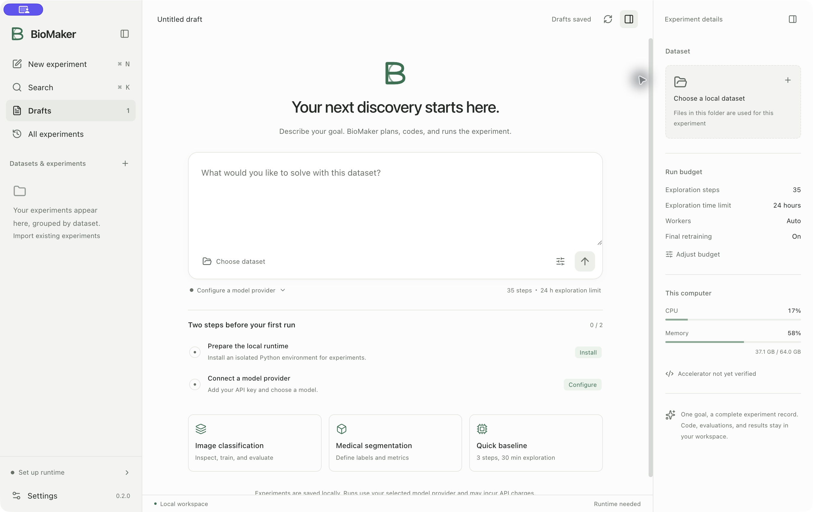

<p align="center">
  
</p>

# BioMaker

BioMaker develops biomedical image analysis models from a task description and
local data. It prepares data, trains and improves candidate models, and exports
the selected model and reports. Use the desktop app, WebUI or command line;
CPU, Apple MPS and NVIDIA CUDA are supported.

## Download

[**BioMaker Desktop 0.2.0 — macOS Apple silicon**](https://drive.google.com/drive/folders/1W-5JySmOb21Tp4SwtEOetSOQsicKQ1zH)

The Google Drive folder contains the DMG, installation instructions and SHA-256
checksums. Drag BioMaker into Applications, then follow the setup guide to install
the engine and configure your model provider. Initial setup requires internet access.
This test build is not Apple-notarized, so macOS may prompt you to allow it to open.

[Desktop guide](apps/desktop/README.md) · [中文安装说明](apps/desktop/docs/QUICKSTART.zh-CN.md)



*BioMaker Desktop — start a new experiment.*

## Run from source

Requires Python 3.11 or 3.12 and [uv](https://docs.astral.sh/uv/).
On macOS, install `libomp` with `brew install libomp` first.

```bash
git clone https://github.com/uni-medical/BioMaker.git
cd BioMaker
uv sync --python 3.11
```

Create a `.env` file in the repository root with your OpenAI-compatible provider:

```dotenv
OPENAI_BASE_URL=https://your-provider.example/v1
OPENAI_API_KEY=your-key
```

Describe your task, labels and evaluation criteria in `task.md`, then run:

```bash
uv run biomaker data_dir=/absolute/path/to/data \
  desc_file=/absolute/path/to/task.md \
  model_for_all_agents=your-model
```

Replace `your-model` with a model supported by your provider. Outputs are saved in
`logs/` and `workspaces/`. Keep your API keys private; model calls may incur charges.

To use the browser interface:

```bash
cd apps/webui
uv run python -m webui.server --host 127.0.0.1 --port 7860
```

Open <http://127.0.0.1:7860>. See the [WebUI guide](apps/webui/README.md) for configuration.

## Acknowledgements

Thanks to medical workers and dataset owners, and to open-source projects
including [MONAI](https://github.com/Project-MONAI) and
[aideml](https://github.com/WecoAI/aideml).
